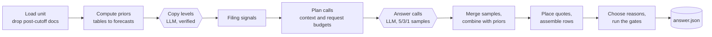

# Explainable Forecasting Agent

An LLM agent that answers forecasting questions about companies, bonds and macro series from a frozen corpus of
financial documents, and explains every number it submits. For each entity in a task it gives a label or a value, a 90%
prediction interval, quoted evidence placed verbatim in the source documents, and up to three graded reasons. Code
computes whatever the data can settle; the language model reads, copies figures, forecasts the rest and writes the
reasons.

Built for **[Agenthon 2026](https://github.com/Agenthon-2026/Agenthon2026-public), Track 4: Explainability**
([official track repository](https://github.com/Agenthon-2026/track4-analysis-public)).

| | |
|---|---|
| Development phase, best | analysis score **0.6634**, leaderboard **+0.5725** (6th at submission, 7 Oct 2026) |
| Final phase | runs 13 to 25 October 2026; standing to be added |
| Code | Python 3.13, about 3,500 lines in 20 modules, 198 tests |

## The task

Each Track 4 unit is one prediction task: a table of entities (companies, Treasury maturities, futures markets, CPI
components, macro series), one target per row, and a corpus of documents dated on or before a cutoff (SEC filings,
FRED and ALFRED vintages, Treasury auction results, CFTC positioning, FOMC statements). The target is a label
(*classification*), a number (*regression*) or a number the rows are ranked by (*ranking*). The ten practice units
cover EPS direction and growth, credit events, post-earnings stock reactions, Treasury yield moves, CPI components,
macro data revisions, auction demand and futures positioning; the Final's held-out set is larger and mostly in
families no practice unit shows.

For every entity the agent returns:

```json
{"entity_id": "UST2Y", "point_forecast": 15.0, "interval": {"level": 0.9, "lo": -83.91, "hi": 113.91},
 "claims": [{"doc_id": "RATES_SNAPSHOT_20240919", "span_start": 2381, "span_end": 2446,
             "claim": "2024-09-19 | 3.93 | 3.59 | 3.47 | 3.49 | 3.6 | 3.73 | 4.11 | 4.06"}]}
```

plus up to three reasons for the unit (premise, mechanism, implication, citations).

**Constraints.** One language model only, the organisers' "House" endpoint serving NVIDIA Nemotron 3 Super
(120B-A12B); 25 requests per unit and 4,000 output tokens per request; 600 seconds per unit inside a container; no data
beyond the unit at inference time.

**Scoring** (scorer 5.2.2). Per unit, `0.7 x prediction quality + 0.3 x interval quality`, both measured against a
private naive baseline (a perfect answer scores 1, the baseline 0.5), times a penalty for false claims: a claim citing
another entity's document, stating a figure its span does not contain, or saying nothing. The leaderboard shows
`-0.27 + 1.27 x analysis`; the Final adds `0.25 x` a reasoning grade on the submitted reasons. A unit that fails the
schema, cites a document dated after the cutoff, crashes or times out scores 0.

## How it works



The design follows a few rules, each backed by a measurement:

- **Data first, the model where it measurably wins.** When a unit's documents hold an entity's history as a dated
  table, code backtests a small menu of standard forecasts (last value, means, median, drift, no change, revision
  medians) on that history and keeps the best. The data's point replaces the model's only where it measured far better:
  the next revision of a macro estimate, and EPS growth from a reported level. Elsewhere the model sets the point and
  the data sets the interval around it.
- **Every number is traceable.** A submitted number comes from a computation on named table rows, which it cites, or
  from the model next to quotes that code places verbatim in the original text. A quote that cannot be found is not
  cited. Zero false claims in 30 local runs.
- **The reasons explain the submitted answer.** What code decides is computed before the model is called and shown on
  the entity's line, so the model argues for the number that is actually submitted.
- **Simple code, every part measured.** Each component has an ablation: what the score loses without it. Components
  within run-to-run noise were removed: a 2,100-line document segmentation stack, corrective turns, a blend weight.
  The code shrank 44% and the score held.
- **Triggered by data shape, never by task names,** so the same code serves families it has never seen.
- **There is always an answer.** A valid answer is written before the first model call; deadlines, request budgets
  and fallbacks keep every unit inside the limits.

The full design, with every component and constant: [docs/design.md](docs/design.md).

## Results

### Development leaderboard

| Submission | Build | What changed | Analysis | Leaderboard |
|---|---|---|---|---|
| 958415 | v3.16k | first build scored by scorer 5.2.2 | 0.4871 | +0.3486 |
| 960771 | v4.12 | the 5.2.2 claim rules, reasons that carry the reasoning | 0.5553 | +0.4353 |
| 960843 | v4.12 | a corrected reply keeps its missing entities | 0.6094 | +0.5039 |
| 961834 | c | computed priors from the corpus's own dated history | 0.5878 | +0.4765 |
| 962251 | c2 | growth prior from copied levels, merged samples | 0.5906 | +0.4801 |
| 966184 | c3 | revision priors, filing signals, spanning merge, yield floor | **0.6634** | **+0.5725** |
| 967146 | c4 | simplification: 44% less code, score held | 0.6560 | +0.5631 |
| pending | c5 | generalization fixes, task facts in the prompt | | |

### What each part is worth

Switched off one at a time on 30 stored runs, change in the 10-unit mean (local estimate):

| Component | Effect |
|---|---|
| Computed priors (forecast menu on the corpus's own history) | -0.037 |
| Copied latest level for growth targets | -0.023 |
| Five samples instead of one | -0.014 |
| Credit signals read from filings | -0.011 |
| Intervals spanning the samples | -0.008 |
| Yield-change interval floor | -0.004 (-0.022 on its unit) |
| Blend of model and prior points (replaced) | +0.002 |
| Corrective turns, asking again, a level guard (removed) | 0.000 |

### Current build (c5), local runs

Ten practice units, three runs each through the submission entrypoint: 30 of 30 clean, 0 false claims, at most 24 of
25 requests and 98 seconds per unit. The local estimate (reconstructed outcomes, stand-in baselines) rose from 0.651
for c4 to 0.673; per unit in [docs/results.md](docs/results.md).

### Final

The Final runs from 13 to 25 October 2026 on held-out units. Standing to be added.

## Engineering notes

- **A generalization audit** read every module for assumptions that hold on the practice units but could fail on
  held-out ones: a planner that refused a unit when two filings did not fit one call, assembly with no clock, an
  entity with nothing citable failing the schema, triggers matching `exchange_rate` as a "change". Each was fixed with
  a test, and an offline replay of 30 stored runs confirmed the practice answers did not move.
- **Budget-aware planning.** Entities that share documents go in one call; large filings are fitted by BM25 windows;
  a group or a plan over the context or request budget gets its documents fitted smaller instead of being refused.
- **Determinism where it matters.** Temperature 0, pinned seeds and dependencies, exact token counts in the model's own
  tokenizer, and a backtest that picks forecast methods per run instead of fitted constants.

## Repository layout

```
solution/            the agent: one module per stage (pipeline, plan, render, priors, forecast, extract,
                     signals, moves, reply, cite, assemble, llm, cli) and solution/tests
baselines/           the organisers' claim and reason checks, used before writing (MIT)
docs/                design, results, walkthroughs of five units, data provenance, and a full HTML guide
scripts/             fetch the practice units and the tokenizer; run one unit
Dockerfile           the submission image (linux/amd64)
```

## Running it

```bash
uv sync                      # Python 3.13; installs the organisers' scorer for the tests
scripts/fetch_units.sh       # the practice units from the official Track 4 repository
scripts/fetch_tokenizer.sh   # the model's tokenizer, for exact token counts as in the image
uv run pytest                # 198 tests, about a minute

export OPENROUTER_API_KEY=...            # any OpenAI-compatible endpoint serving the model
scripts/run_unit.sh t4-fomc-curve-20240918

docker build --platform linux/amd64 -t explainable-forecasting-agent .
docker run --rm -v "$PWD/units/t4-fomc-curve-20240918:/input:ro" -v "$PWD/out:/output" \
  -e MODEL_ENDPOINT=https://openrouter.ai/api/v1 -e MODEL_NAME=nvidia/nemotron-3-super-120b-a12b:free \
  -e OPENROUTER_API_KEY explainable-forecasting-agent \
  analyze --task /input/task.json --corpus /input/corpus/ --out /output/answer.json
```

## Documentation

- [docs/design.md](docs/design.md): principles, pipeline, every component with its constants and measured effect
- [docs/results.md](docs/results.md): leaderboard history, ablations, per-unit metrics, the generalization fixes
- [docs/walkthroughs.md](docs/walkthroughs.md): five practice units followed through a real run
- [docs/provenance.md](docs/provenance.md): every constant and data source, and how cutoffs are respected
- [docs/guide.html](docs/guide.html): all of the above as one illustrated page

## References

- Agenthon 2026 shared toolkit and rules: <https://github.com/Agenthon-2026/Agenthon2026-public>
- Track 4 (Explainability) task repository, scorer and practice units: <https://github.com/Agenthon-2026/track4-analysis-public>
- Data in the practice units: SEC EDGAR, FRED and ALFRED (Federal Reserve Bank of St. Louis), BLS, CFTC Commitments of
  Traders, TreasuryDirect, Federal Reserve FOMC statements.

## License

MIT for this repository's code (`LICENSE`); third-party material and its terms in
[THIRD_PARTY_NOTICES.md](THIRD_PARTY_NOTICES.md).
